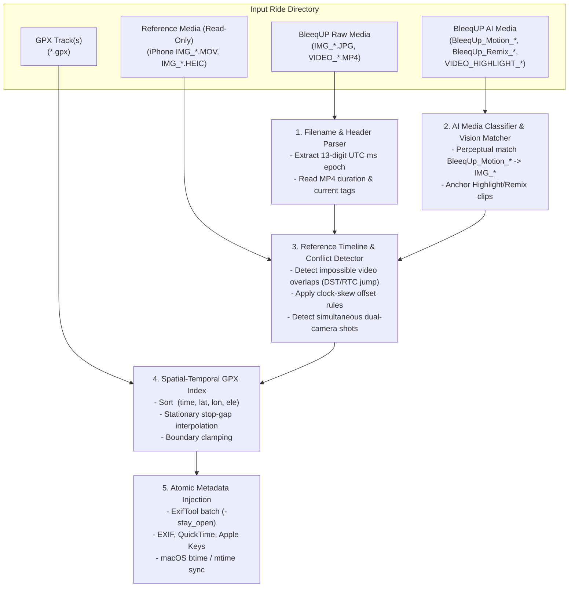

# Technical Specification & Architecture: `bleequp-ranger-sync`

## 1. System Architecture

---

## 2. Real-World Dataset Forensics (`2026-10-31_PCH,Can_Picafort`)

Analysis of the October 31, 2026 Mallorca ride dataset (`7,218` GPX trackpoints from `07:44:10Z` to `10:32:19Z`, `25` iPhone files, `34` BleeqUP files) uncovered four critical behaviors that the tool must handle:

### A. The "+1 Hour Out of Order" Anomaly (Pre-Sync RTC / DST Skew)
- **Symptom:** Seven files captured at the start of the ride (`08:58`–`09:07` CET, on the coastal bike path past Restaurant Can Cuarassa and Hotel Uyal into Pro Cycle Hire in Port de Pollença) have filename epochs between `10:02:48` and `10:11:16` CET (`09:02:48Z`–`09:11:16Z`).
- **Root Cause:** BleeqUP Ranger glasses rely on an internal RTC that only syncs when connected via Bluetooth to the BleeqUP iPhone app. Prior to connecting at Pro Cycle Hire (~`09:10` CET), the glasses' clock was still on CEST (`+1h`) plus `+3m 57s` of quartz drift (`+3,837s` total). When the glasses connected to the phone at Pro Cycle Hire, their clock jumped backward by `1h 03m 57s`.
- **Automatic Detection Signal:**
  - `VIDEO_1793437571094.MP4` is a continuous `180.0s` video recorded from `09:06:11Z` to `09:09:11Z` during the group ride inland.
  - Three pre-sync files (`IMG_1793437637238.jpg` at `09:07:17Z`, `VIDEO_1793437646586.MP4` [`60s`] at `09:07:26Z`, and `VIDEO_1793437709396.MP4` [`60s`] at `09:08:29Z`) fall **inside** that 3-minute video window—an impossible physical overlap for a single camera.
  - Similarly, `VIDEO_1793437876579.MP4` (`09:11:16Z`–`09:12:01Z`, recorded inside Pro Cycle Hire) overlaps `IMG_1793437894025.jpg` (`09:11:34Z`, riding behind a cyclist inland).
- **Resolution:** Shifting those 7 pre-sync files by `-3837s` (`-1h 03m 57s`) places every single shot onto its exact physical landmark on the GPX track:

| File | Raw Filename Time (CET) | Corrected Time (`-3837s` CET) | Landmark & GPX Verification |
| :--- | :--- | :--- | :--- |
| `VIDEO_1793437368668.MP4` | `10:02:48` | `08:58:51` | Rainbow on bay cycle path (`39.8715, 3.0859`) |
| `IMG_1793437400537.JPG` | `10:03:20` | `08:59:23` | Rainbow at Restaurant Can Cuarassa (`39.8738, 3.0845`) |
| `IMG_1793437486125.jpg` | `10:04:46` | `09:00:49` | Rainbow with two cyclists on bay (`39.8796, 3.0815`) |
| `IMG_1793437637238.jpg` | `10:07:17` | `09:03:20` | Hotel Uyal seafront, Port de Pollença (`39.8905, 3.0783`) |
| `VIDEO_1793437646586.MP4` | `10:07:26` | `09:03:29` | Port de Pollença beachfront promenade (`39.8912, 3.0783`) |
| `VIDEO_1793437709396.MP4` | `10:08:29` | `09:04:32` | Turning off seafront toward PCH (`39.8956, 3.0784`) |
| `VIDEO_1793437876579.MP4` | `10:11:16` | `09:07:19` | Inside Pro Cycle Hire cafe (`39.8973, 3.0755`) |

### B. All 5 BleeqUP Filename Patterns
1. **Raw Capture Photos:** `^IMG_(\d{10})(\d{3})\.(jpg|jpeg)$` (case-insensitive)
2. **Raw Capture Videos:** `^VIDEO_(\d{10})(\d{3})\.(mp4|mov)$` (case-insensitive)
3. **AI Motion Stylized Photos:** `^BleeqUp_Motion_(\d{10})(\d{3})\.(png|jpg|jpeg)$`
   - Matched via macOS `Vision` (`VNGenerateImageFeaturePrintRequest`) to the closest `IMG_*` capture:
     - `BleeqUp_Motion_1793450679296.{PNG,jpg}` $\rightarrow$ `IMG_1793440997373.jpg` (Playa de Muro tourist train, feature distance `0.584`)
     - `BleeqUp_Motion_1793450741057.{PNG,jpg}` $\rightarrow$ `IMG_1793437400537.JPG` (Can Cuarassa rainbow, feature distance `0.768`)
   - By default, keeps the AI generation timestamp as-is (or optionally shifts to `source_timestamp + 1s` when `--sync-ai-motion-time` is passed) while inheriting the matched source photo's exact GPS coordinates and recording provenance in `EXIF:UserComment`.
4. **AI Highlight Video:** `^VIDEO_HIGHLIGHT_(\d{10})(\d{3})\.mp4$`
5. **AI Remix Video:** `^BleeqUp_Remix_(\d{10})(\d{3})_ai\.mp4$`

### E. iPhone Finder `Files -> BleeqUp` Container Artifacts
When the iPhone is connected to macOS Finder (`Files` tab $\rightarrow$ `BleeqUp`), the app exposes its documents container (`UIFileSharingEnabled`):
- `1793432585471.gpx` (`08:43:05 CET`, modified `09:09 AM`) and `1793434466864.gpx` (`09:14:26 CET`, modified `11:46 AM`): BleeqUp's own phone-recorded GPX tracks, split right at the `09:06`–`09:09 AM` Pro Cycle Hire stop where `agorasdk.1.log` (`09:06 AM`) re-initialized the glasses connection and snapped the glasses' RTC back by `1h 03m 57s`.
- `app_database.db`: Local SQLite database maintained by the BleeqUp iOS app.
- `imuout_<13-digit-ms>.csv`: Per-clip IMU gyroscope/accelerometer telemetry files named with the same 13-digit epoch ms as the video clips.
- `ranger-sync` automatically ingests multiple `.gpx` files if dragged into the ride folder and ignores non-media sidecars (`*.csv`, `*.log`, `*.db`).

### C. Stationary Stop-Gap Interpolation in GPX
- At Pro Cycle Hire (`39.8973, 3.0755`), the GPX recording paused from `08:05:50Z` to `08:39:03Z` (`33m 13s`), while spatial distance between the two trackpoints is only **46 meters**.
- **Rule:** Given bracketing trackpoints $(t_a, \text{lat}_a, \text{lon}_a)$ and $(t_b, \text{lat}_b, \text{lon}_b)$ with $t_a \le t \le t_b$:
  - If $\min(t - t_a, t_b - t) \le \Delta t_{\text{moving}}$ (default `120s`), **OR** haversine distance $d(P_a, P_b) \le \Delta d_{\text{stationary}}$ (default `150m`) and $t_b - t_a \le \Delta t_{\text{stationary}}$ (default `7200s` = 2 hours), linearly interpolate latitude, longitude, and elevation.
  - If $t$ is within `--boundary-tolerance` (default `300s`) before the first GPX point or after the last GPX point, clamp to the boundary point.

### D. Metadata Injection Matrix (`exiftool`)

| Target Format | Metadata Group | Tags Written | Value / Timezone Rule |
| :--- | :--- | :--- | :--- |
| **Photos (`.JPG`, `.PNG`)** | EXIF / IFD0 | `Make="BleeqUP"`, `Model="Ranger"` | Device identification for Apple Photos / Lightroom |
| | EXIF / SubIFD | `DateTimeOriginal`, `CreateDate`, `ModifyDate` `SubSecTimeOriginal`, `OffsetTimeOriginal`, `OffsetTime` | Local time (`YYYY:MM:DD HH:MM:SS`), milliseconds (`SSS`), and IANA TZ offset (`+01:00`) |
| | EXIF / GPS | `GPSLatitude`, `GPSLongitude`, `GPSAltitude` `GPSLatitudeRef`, `GPSLongitudeRef`, `GPSAltitudeRef` `GPSDateStamp`, `GPSTimeStamp` | Interpolated WGS84 coordinates & UTC GPS timestamp |
| **Videos (`.MP4`)** | QuickTime / ItemList | `Make="BleeqUP"`, `Model="Ranger"` | Device identification |
| | QuickTime Atoms | `QuickTime:CreateDate`, `QuickTime:ModifyDate` `TrackCreateDate`, `MediaCreateDate` | **UTC** (`YYYY:MM:DD HH:MM:SS`) per QuickTime specification |
| | Apple Keys / UserData | `Keys:CreationDate`, `UserData:DateTimeOriginal` | **Local ISO 8601 with TZ offset** (`YYYY:MM:DD HH:MM:SS+01:00`) — required by Apple Photos |
| | QuickTime / Keys GPS | `Keys:GPSCoordinates`, `UserData:GPSCoordinates` | ISO 6709 string (`+39.8738+003.0845+005.2/`) |
| **macOS Filesystem** | Inode (`btime`, `mtime`) | `FileCreateDate`, `FileModifyDate` | Local timestamp with offset (restores chronological sorting in Finder) |
